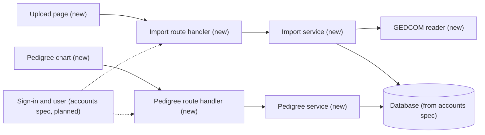
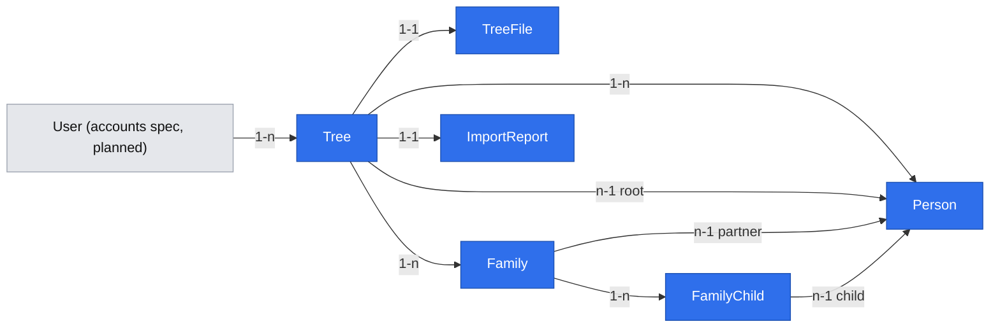

# GEDCOM import and direct-ancestors view

Depends on: the user-accounts spec (not yet written; product brief D05). This spec must not ship before it, and requires from it:
- a Next.js (App Router, TypeScript) application and its deployment;
- a relational database with migrations (PostgreSQL proposed) and a `User` record with a stable `id`;
- a server-side helper that returns the signed-in user or rejects the request;
- a way for the maintainer to mark an account as allowed to import (an allowlist flag or role), used until Q07 is closed.

## 📝 TLDR
A family researcher who keeps their tree in MyHeritage cannot see only their direct line: MyHeritage's limited view still shows relatives down to cousins. Proposed future behavior: a signed-in Antenat user uploads a GEDCOM file of any version Antenat can read, Antenat stores it on the server as uploaded and shows all of the chosen person's direct ancestors as a pedigree chart, with siblings and ancestors' other spouses never shown. This is the import-and-view part of the first version agreed in the product brief (D06, D07); accounts and cloud-drive integration are separate specs.

## 📝 Problem Statement
The founder researches their family in MyHeritage and wants to browse only direct ancestors, without siblings and without ancestors' other spouses (spouses who are not themselves direct ancestors). MyHeritage's limited mode stops at cousins, so the founder finds the tree inconvenient to browse (product brief: Problems, A04 held, Domain glossary "Direct ancestors"). The evidence is the founder's own account; other researchers' needs are untested (A01).

The founder's own export (GEDCOM 5.5.1, UTF-8 with BOM, CRLF line ends, 128 people, 45 families) supports the view: all 32 recorded direct ancestors, across 7 generations, are reachable through parent links (`research/data/2026-11-11-gedcom-export-check.md`). The file has no root-person marker, so the user must choose whose ancestors to show. It also carries e-mail and postal addresses of living people.

Decisions taken for this spec by the founder on 2026-11-12: accounts get their own spec and ship first; the tree is stored in a server database and GEDCOM files are always kept on the server; the stack is Next.js; the view is a pedigree chart; cloud-drive integration (Google Drive and similar, for syncing GEDCOM files and as free storage for photos and documents) is its own spec. Revised by the founder on 2026-11-14: the file is kept as uploaded, contact data included unless the user opts out at import (D17, superseding D12); any GEDCOM version is accepted as far as possible (D18, superseding D15); the chart shows all generations by default, with a control to limit them.

## 📝 Proposed Solution
1. The signed-in user uploads a `.ged` or `.gdz` file, confirms consent to storing it (R01) and leaves on, or turns off, the option to import contact data.
2. Antenat validates the header, stores the file as uploaded (or, with the option off, without the contact data of presumed-living and unknown-status people), parses individuals, families and parent links into its database, and shows an import report: counts, warnings, what it skipped and why.
3. The user picks the person whose ancestors to show (the root). Antenat remembers the choice for that tree.
4. Antenat shows a pedigree chart: the root, then one column per generation of parents, all generations by default. Siblings and ancestors' other spouses are never part of the chart, because the chart only follows parent links upward.
5. The user can delete a tree, which removes the stored file and every parsed record.

Success check (D09): the founder imports their MyHeritage export and browses all 32 recorded direct ancestors without siblings.

Alternatives considered:
- **Parse in the browser and store nothing** (lost to the founder's choice of server storage): smallest privacy exposure, but no persistence across devices and no path to sync.
- **An existing npm GEDCOM parser** (`parse-gedcom`, `read-gedcom`): written for GEDCOM 5.x; GEDCOM 7 support was not verified. GEDCOM's line grammar is small and shared by every version, so the proposal is a narrow in-house reader of the tags this slice uses, tested against fixtures. Phase 1 re-checks this choice against the fixtures before committing to it.
- **Store only parsed records, not the file:** less personal data at rest, but contradicts the founder's choice that GEDCOM files always stay on the server, as uploaded.
- **Remove living people's contact data by default** (the 2026-11-12 choice, D12): superseded by the founder's choice to keep everything unless the user opts out (D17).

Market comparison was not sourced in this session. The Phase 4 spike compares the chart with open-source genealogy tools (for example webtrees, Gramps Web, Topola) and records what it borrows. Proposed borrowings to confirm there: a presumed-living rule, pan and zoom for wide charts, and click-to-recentre. Skipped for now: editing, merging, multiple chart types, media.

## 📝 Delta

### Capability: gedcom-import

#### ADDED Requirement: Import a GEDCOM file
The system SHALL let a signed-in user upload a GEDCOM file of any version that has a GEDCOM header, store the file as uploaded, store its parsed individuals, families and parent links as a tree owned by that user, and show an import report.

##### Scenario: MyHeritage 5.5.1 export
- WHEN a signed-in user uploads a valid GEDCOM 5.5.1 file encoded as UTF-8 with a byte-order mark and CRLF line ends, and confirms consent
- THEN a new tree owned by that user is created, and the report shows the number of individuals and families imported

##### Scenario: Nothing is removed by default
- WHEN the uploaded file holds e-mail addresses, phone numbers or postal addresses, and the user leaves the option to import contact data on
- THEN the stored file is byte-identical to the upload

##### Scenario: User opts out of contact data
- WHEN the user turns the option to import contact data off before importing
- THEN the stored file keeps every line except the e-mail, phone and address structures of presumed-living and unknown-status people, and the report says how many were removed

##### Scenario: Other GEDCOM versions
- WHEN a signed-in user uploads a valid GEDCOM 5.5, 5.5.5 or 7.0 file, or a `.gdz` archive holding a GEDCOM 7.0 file, and confirms consent
- THEN a new tree is created as for 5.5.1

##### Scenario: Unknown version
- WHEN the file has a GEDCOM header that declares no version or a version Antenat does not know
- THEN Antenat reads it as GEDCOM 5.5.1, creates the tree, and the report warns that the version was not recognised

##### Scenario: Legacy encoding
- WHEN the file declares the ANSEL or ANSI character set
- THEN its text is decoded to Unicode, including Polish diacritics, before parsing

##### Scenario: Not a GEDCOM file
- WHEN the file has no GEDCOM header, or its text cannot be decoded with the declared or detected encoding
- THEN no tree is created and the user sees which check failed

##### Scenario: No consent
- WHEN the user uploads a file without confirming consent
- THEN nothing is stored

#### ADDED Requirement: Report what was not imported
The system SHALL list in the import report each record or link it skipped, with the reason, without failing the whole import.

##### Scenario: Broken parent link
- WHEN a family points to an individual that does not exist in the file
- THEN the import succeeds, the link is skipped, and the report names the family and the missing reference

#### ADDED Requirement: Delete a tree
The system SHALL let the owner delete a tree, removing the stored file and every record parsed from it.

##### Scenario: Owner deletes a tree
- WHEN the owner deletes a tree
- THEN the tree, its file, its people, families and links are gone, and the tree no longer appears in the owner's list

#### ADDED Requirement: Import only for allowed accounts until Q07 is closed
The system SHALL accept imports only from accounts the maintainer has marked as allowed to import, until the founder closes Q07 (product brief D10).

##### Scenario: Allowed account
- WHEN an account marked as allowed uploads a valid GEDCOM file with consent
- THEN the import proceeds

##### Scenario: Other account
- WHEN a signed-in account not marked as allowed opens the upload page or calls the import endpoint
- THEN no tree is created and the user is told that importing is not open yet

#### ADDED Requirement: Trees are private to their owner
The system SHALL show a tree, its file and its people only to the user who imported it.

##### Scenario: Another user asks for a tree
- WHEN a signed-in user requests a tree they do not own
- THEN the system answers as if the tree did not exist

### Capability: ancestors-view

#### ADDED Requirement: Choose the root person
The system SHALL let the owner search the people of a tree by name and set one as the tree's root, and SHALL remember that root.

##### Scenario: Founder picks their own record
- WHEN the owner searches for a name and selects a person
- THEN the pedigree chart is drawn from that person, and the same root is used the next time the tree is opened

#### ADDED Requirement: Show direct ancestors only
The system SHALL show the root's direct ancestors as a pedigree chart, one column per generation, following only parent links upward, and SHALL NOT show siblings or spouses who are not themselves direct ancestors.

##### Scenario: Founder's tree
- WHEN the founder's MyHeritage export is imported and the founder's record is the root
- THEN all 32 recorded direct ancestors can be reached in the chart, and no sibling or other spouse of an ancestor appears

##### Scenario: Synthetic seven-generation tree
- WHEN the seven-generation fixture is imported and its root is chosen
- THEN every direct ancestor in the fixture can be reached in the chart, and none of its siblings or other spouses appears

##### Scenario: Ancestor with two marriages
- WHEN an ancestor has a second spouse who is not a parent of the next generation down
- THEN that spouse does not appear in the chart

##### Scenario: Same ancestor twice
- WHEN a person is a direct ancestor through two lines (pedigree collapse)
- THEN the person appears in each position; the first position shows their ancestors, and every later box is marked as repeated, links to the first, and is not expanded again

##### Scenario: Loop in parent links
- WHEN the parent links lead back to a person already on the current line (a data error)
- THEN the chart stops that line at the repeated person and marks the break

##### Scenario: Birth and adoptive parents
- WHEN a person is a child in more than one family
- THEN the chart follows the family marked as birth, or the only family without a pedigree mark, and lists the other families on the person's box as other parents

##### Scenario: Parents shown as recorded
- WHEN a family has partners recorded as husband and wife
- THEN the chart shows the husband in the upper slot and the wife in the lower slot, without inferring roles from sex

#### ADDED Requirement: Show all generations, with an optional limit
The system SHALL show every recorded generation of direct ancestors by default, SHALL let the user limit the number of generations shown, and SHALL let the user recentre the chart on any shown ancestor.

##### Scenario: Default view
- WHEN the owner opens the chart of a tree whose deepest line has 12 generations
- THEN all 12 generations are shown, and the user can pan and zoom to reach every box

##### Scenario: User limits generations
- WHEN the user sets the generation control to 3
- THEN only the root and three generations of ancestors are shown, and setting it back to all shows every generation again

##### Scenario: Recentre
- WHEN the user selects an ancestor
- THEN the chart is redrawn with that ancestor at its start, and the user can return to the root

#### ADDED Requirement: Mark living status
The system SHALL give every person one living status, applying these rules in order: a death record makes the person deceased; otherwise a birth year within the last 110 years makes them presumed living, and an older birth year presumed deceased; otherwise a recorded birth year of any of their children more than 110 years ago makes them presumed deceased; otherwise the status is unknown. A date given as a range or an approximation uses its latest year. The chart marks presumed living and unknown people.

##### Scenario: Living parent
- WHEN the root's parent has a birth year within the last 110 years and no death record
- THEN the parent's box is marked as presumed living

##### Scenario: Death record without dates
- WHEN a person has a death record with no date and no birth date
- THEN the person is deceased

##### Scenario: Boundary year
- WHEN a person without a death record was born exactly 110 years before the current year
- THEN the person is presumed living

##### Scenario: Range date
- WHEN a person without a death record has a birth date given as a range from 1900 to 1920, and the current year is 2026
- THEN the latest year, 1920, is used, and the person is presumed living

##### Scenario: No dates at all
- WHEN a person has no death record, no birth date and no child with a birth year
- THEN the status is unknown and the box says so

## 📝 Architecture
- **Next.js app (App Router, TypeScript)**, from the accounts spec: route handlers for the API below, React server and client components for the upload page, the import report, root selection and the chart. Authentication and the user record come from the accounts spec; every handler here requires a signed-in user and checks tree ownership.
- **GEDCOM reader** (new, pure TypeScript module with no I/O): detects the encoding from the byte-order mark and `HEAD.CHAR` and decodes UTF-8, UTF-16, ANSEL and ANSI (a Windows code page) to Unicode; normalizes line ends; reads `level [xref] tag [value]` lines into records; joins `CONT` and `CONC` whatever the declared version; and maps `INDI`, `FAM`, `HUSB`, `WIFE`, `CHIL`, `FAMC`, `FAMS`, `NAME`/`GIVN`/`SURN`, `SEX`, `BIRT`/`DEAT` with `DATE` and `PLAC`, and `PEDI`. It ignores other tags and counts them in the report. It reads the version from `HEAD.GEDC.VERS` and records it as text. The tags it maps exist in every version from 5.5 to 7.0; the differences it handles (for example `CONC` dropped and UTF-8 required in 7.0, `@VOID@` pointers, the `.gdz` archive, ANSEL in 5.5 and 5.5.1, which code page `ANSI` means) are verified against the published specifications in Phase 1, not assumed from this list. A `.gdz` archive is unpacked and its GEDCOM file read; its media files are counted in the report and not imported.
- **Import service** (new): validates, stores the file, runs the reader, writes the records in one database transaction, and returns the report.
- **Pedigree service** (new): walks parent links upward from the root, to the end of every line or to a requested depth, and returns a nested structure. It reads only parent links, which is what keeps siblings and other spouses out. A person reached a second time is returned as a repeated reference and not expanded again, so the result grows with the number of people in the tree, not with the number of positions in a full binary tree.
- **Pedigree chart** (new client component): boxes per generation with SVG connectors, with pan and zoom, because all generations are shown by default. A small dependency is acceptable if it renders a plain ancestor tree; otherwise hand-drawn SVG. Decided in Phase 4.
- **Persistence**: the relational database the accounts spec introduces (PostgreSQL proposed there). Original files in a database column at first, behind a storage interface so that object storage, or the cloud-drive spec's sync, can replace it.

Every request goes through the accounts spec's sign-in; the reader has no database or network access, so it can be tested on files alone.

## 📝 Data Model

- **Tree**: `id`, `ownerId` → User, `name` (from the file name, editable later), `gedcomVersion` (text as declared, empty when the header has none), `sourceSystem` (from `HEAD.SOUR`, e.g. `MYHERITAGE`), `rootPersonId` → Person (nullable), `consentGivenAt`, `importedAt`.
- **TreeFile**: `treeId` (1-1), `fileName`, `sizeBytes`, `sha256` (of the uploaded file), `content` (bytes: the file as uploaded, `.ged` or `.gdz`; with the contact-data option off, without the contact data of presumed-living and unknown-status people), `contactDataImported` (boolean). One per tree; re-importing creates a new tree.
- **Person**: `id`, `treeId`, `xref` (unique within the tree), `givenNames`, `surname`, `sex`, `birthDateText`, `birthYear`, `birthPlace`, `deathDateText`, `deathYear`, `deathPlace`, `hasDeathRecord`. Dates keep the original text, because GEDCOM dates can be ranges or approximate; the year (the latest year of a range) is parsed only for the living-status rule and display.
- **Family**: `id`, `treeId`, `xref`, `partner1Id` → Person (nullable, from `HUSB`), `partner2Id` → Person (nullable, from `WIFE`). Named neutrally; the chart shows them as recorded and never infers roles from `SEX`.
- **FamilyChild**: `familyId`, `childId` → Person, `pedigree` (`birth` | `adopted` | `foster` | `other` | `unknown`, from `PEDI`; `unknown` when absent).
- **ImportReport**: `treeId` (1-1), `individuals`, `families`, `skipped` (list of `{record, reason}`), `ignoredTagCounts`, `warnings` (for example an unrecognised version), `mediaFilesNotImported` (count, for `.gdz`), `contactDataRemoved` (count, zero unless the user opted out).
- **Not stored as records:** contact data (`EMAIL`, `PHON`, `ADDR`, residence addresses), notes, sources and media. They stay in the stored file, which keeps everything the user uploaded (product brief D17), so later features can parse them without a re-import.
- Deleting a Tree cascades to all of the above.

User is drawn grey because it will come from the accounts spec; no schema exists in the repository yet.

## 📝 API Contracts
All handlers require a signed-in user and return 404 for a tree the user does not own.

- `POST /api/trees` — multipart: `file` (`.ged` or `.gdz`, at most 20 MB), `consent` (`true`), `importContactData` (`true` by default). 201 `{ treeId, report }`. 400 `{ error: "not-gedcom" | "unsupported-encoding" | "too-large" | "consent-required" }`. An unknown version is not an error; it is a warning in the report.
- `GET /api/trees` — 200 `[{ treeId, name, gedcomVersion, importedAt, rootPersonId }]`.
- `GET /api/trees/:treeId/report` — 200 `ImportReport`.
- `GET /api/trees/:treeId/people?query=` — name search, at most 20 results: `[{ personId, displayName, birthYear, deathYear }]`.
- `PUT /api/trees/:treeId/root` — `{ personId }`; 204, or 404 when the person is not in the tree.
- `GET /api/trees/:treeId/pedigree?rootId=&generations=` — `generations` is the number of ancestor generations, a positive integer, optional; when absent, every generation is returned. `rootId` defaults to the tree's root. 200 `{ person, livingStatus, repeated, loopBreak, deeperGenerations, parents: [{ slot: "partner1" | "partner2", node }], otherParentFamilies: number }`, nested through `node`. `partner1` comes from `HUSB`, `partner2` from `WIFE`. `repeated` nodes carry no `parents`. `deeperGenerations` is true when `generations` cut the line short. 409 when the tree has no root and none is given.
- `POST /api/trees` returns 403 `{ error: "import-not-open" }` for an account not allowed to import.
- `DELETE /api/trees/:treeId` — 204.

## 📝 UI/UX
- **Upload:** file picker; a consent checkbox stating that the file, including data about living relatives, will be stored on Antenat's server and can be deleted at any time; and a checkbox "Import contact data (e-mail, phone, addresses)", on by default, whose help text says that, when off, these are removed for living people and people of unknown status. The import button stays disabled until a file is chosen and consent is given.
- **Import report:** counts first, then warnings, then skipped items. Then "Choose whose ancestors to show".
- **Root selection:** a name search with birth and death years, to tell apart people with the same name (the founder's file has two people with the founder's name).
- **Chart:** the root on the left and generations to the right, every generation by default, with pan and zoom and a generation control (all, or a number). Each box shows the name and the birth and death years and places as recorded. Presumed-living people and people with unknown status are marked. A missing parent shows as one empty slot, so the user sees where the line ends; nothing is drawn beyond it. A repeated ancestor's box links to their first position. Selecting an ancestor recentres the chart on them, with a way back.
- **States:** empty (no trees yet), importing, import failed (the reason from the API), no root chosen, a root with no recorded parents, loading the chart, error loading the chart.
- **Accessibility:** the chart has a text alternative: a list of ancestors by generation that screen readers and keyboard users can navigate.

Prototype: none accepted.

## 📝 Edge Cases & Failure Scenarios
- **Repeated ancestors, loops, and birth and adoptive parents:** see the scenarios of "Show direct ancestors only".
- **Family with one partner:** the missing parent is an empty slot.
- **Very large file:** files over 20 MB are refused before parsing. Within the limit, the import runs inside the request; when it fails, the transaction rolls back and nothing is kept.
- **Same file uploaded twice:** a second tree is created; the list shows both with their import dates. Deduplication is out of scope.
- **ANSEL or ANSI encodings** (older exports): decoded. A file whose bytes are invalid for the declared encoding is refused with a message naming the encoding.
- **Files from before GEDCOM 5.5, or with no version:** read as 5.5.1 with a warning; whatever cannot be read is listed as skipped.
- **GEDCOM 7 `@VOID@` pointers:** treated as a missing link, not reported as an error.
- **`.gdz` archives** (GEDCOM 7 with media): the GEDCOM file inside is imported and the archive is stored as uploaded; media are not imported and belong to the later documents-and-photos work.
- **Very wide or deep trees:** all generations are shown by default, so the chart must stay usable with hundreds of boxes; repeated ancestors are not expanded twice, and the generation control is the user's way to narrow the view.

## 📝 Risks & Impact Review
- **Contact data in uploaded files.** The founder's file has e-mail and postal addresses of living people, and nothing in this spec uses them. The founder chose on 2026-11-14 to keep the file as uploaded, contact data included, unless the user turns the contact-data option off at import (product brief D17, superseding D12). Antenat therefore stores living relatives' contact data by default, which makes Q07 weigh more before release to other users. The `sha256` of the upload is kept to recognise re-uploads.
- **Living relatives (Q07, D10):** this spec does not settle the legal basis for storing data about living relatives who do not use Antenat. It limits exposure: owner-only access, the living-status mark, no contact data in parsed records, the opt-out at import, full deletion, and import only for allowed accounts until Q07 is closed, which is how D10 is enforced.
- **Personal data in tests and the repository:** the repository is public on 2026-11-14 and is to become private (product brief D19). Until it is private, the founder's real export is never committed; git history keeps a file even after visibility changes. Fixtures are synthetic either way, because they must cover cases the founder's file does not have (loops, `@VOID@`, UTF-16, ANSEL, `.gdz`, a deep tree). Once the repository is private, the founder's export may be added as a fixture and the D09 check may run in CI.
- **Consent wording** is a legal text the founder must approve before release. A placeholder is acceptable before that.
- **Dependency on the accounts spec:** this spec cannot ship first. If accounts slip, the import cannot be used, by the founder's choice.
- **Hard to reverse:** the Tree, Person and Family schema becomes the base for the journey view, statistics and the cloud-drive sync. Keeping the original date and place text, not only parsed values, avoids re-imports later.

## 📝 Decisions in play
- Relies on: D02 (GEDCOM import), D05 (accounts; here, a dependency), D06 (first version: accounts, import, direct-ancestors view; journey view later), D07 (web application), D09 (outcome check), D10 and Q07 (living relatives block release, not planning; the design must cover them), R01 (data stored only with consent and in line with GDPR and Polish and EU law), N01 (no archive search), N02 (no two-way sync with MyHeritage).
- Proposes to supersede: none. Owner of all: the founder.
- Also relies on the founder's choices recorded in the brief: D11 (accounts first, in their own spec), D13 (Next.js), D14 (pedigree chart), D16 (cloud drives in their own spec), D17 (server storage; files kept as uploaded, contact data unless the user opts out; supersedes D12), D18 (any GEDCOM version as far as possible; supersedes D15), D19 (the repository becomes private; real data stays out of it until then).

## 📋 Phasing
- **Phase 1: GEDCOM reader.** A pure module with synthetic fixtures, every supported version and encoding, the living-status rule and the contact-data opt-out. Usable on its own in tests; no user-facing change.
- **Phase 2: Import and storage.** Upload with consent, validation, storage, import report, tree list, delete. After this phase a user can import, see the report and delete.
- **Phase 3: Root and pedigree API.** People search, root selection, pedigree walk.
- **Phase 4: Pedigree chart.** The chart, its states and its text alternative. Ends with the D09 check.

## 📋 Implementation Plan
Prerequisite: the accounts spec is implemented (Next.js app, database, sign-in).

### Phase 1: GEDCOM reader
1. Check the published GEDCOM 5.5, 5.5.1, 5.5.5 and 7.0 specifications for the differences the reader handles (encodings, `CHAR` values, `CONC`, `@VOID@`, `.gdz` layout), and record them in the PR. Add synthetic fixtures under `tests/fixtures/gedcom/`: a 5.5.1 file shaped like a MyHeritage export (UTF-8 with BOM, CRLF, `_UID`/`RIN` extension tags, `EMAIL`/`ADDR` on residence, 7 generations, a second marriage, a family with one partner, a broken pointer), a 5.5 file in ANSEL and one in ANSI with Polish diacritics, a 5.5.5 file in UTF-16, a GEDCOM 7.0 file with `@VOID@` and `PEDI`, a `.gdz` archive, a file with an unknown version, a 12-generation file with pedigree collapse, and a non-GEDCOM file. Test: each fixture is valid for the version it declares, per the checked specifications.
2. Implement line reading: encoding detection and decoding, BOM, line ends, `CONT`/`CONC`, records by xref, `.gdz` unpacking. Test: the line and record counts of each fixture, and the decoded diacritics of the ANSEL and ANSI fixtures.
3. Map individuals, families and parent links, with skip reasons and ignored-tag counts. Test: the expected counts and skips per fixture, and that `EMAIL`/`ADDR` never reach the output.
4. Implement the living-status rule as a pure function, then the contact-data opt-out: the uploaded lines with contact-data structures of presumed-living and unknown-status people removed. Test: every scenario of "Mark living status"; with the option on, the stored bytes equal the upload; with it off, the MyHeritage-shaped fixture loses every `EMAIL`/`PHON`/`ADDR` of living and unknown-status people, keeps everything else line for line, and still parses to the same records.
5. Re-check the in-house reader against `parse-gedcom` on the fixtures, and record the outcome in the PR. Test: the comparison script.

### Phase 2: Import and storage
6. Add the Tree, TreeFile, Person, Family, FamilyChild and ImportReport schema with cascade delete. Test: migrate up and down; deleting a Tree removes all children.
7. Implement `POST /api/trees` with consent, size, header and encoding checks, the contact-data option, version warnings, and a single transaction. Test: one integration test per Delta scenario of "Import a GEDCOM file", plus a rollback test.
8. Gate import on the account's allowed-to-import mark from the accounts spec. Test: one integration test per scenario of "Import only for allowed accounts until Q07 is closed".
9. Implement `GET /api/trees`, `GET /api/trees/:treeId/report` and `DELETE /api/trees/:treeId` with owner checks. Test: an owner sees and deletes their tree; another user gets 404.
10. Add the upload page and the import report page with their states. Test: a component test for consent gating and the contact-data option being on by default; an end-to-end upload of the 5.5.1 fixture.

### Phase 3: Root and pedigree API
11. Implement people search and `PUT /api/trees/:treeId/root`. Test: search by surname and given name; setting a root from another tree returns 404.
12. Implement the pedigree walk to the end of every line or an optional depth, with repeated ancestors returned once and referenced afterwards, the loop guard, the birth-family preference and the living status from step 4. Test: on the 7-generation fixture, the walk returns only ancestors, never siblings or other spouses; on the 12-generation fixture, every generation is returned without a depth and each repeated ancestor is expanded once; the loop and birth-and-adoptive scenarios.
13. Implement `GET /api/trees/:treeId/pedigree`. Test: the 409 without a root, all generations without `generations`, a cut-off with `deeperGenerations`, a 400 for a non-positive `generations`, and owner checks.

### Phase 4: Pedigree chart
14. Choose the rendering approach (a small library or hand-drawn SVG) on a spike against the 12-generation fixture, and record the choice in the PR. Test: the spike renders every generation of the fixture with pan and zoom.
15. Build the chart with all generations by default, pan and zoom, the generation control, recentring, empty slots, repeated-ancestor links and the presumed-living mark. Test: component tests on the fixtures; end-to-end generation control, selection and recentring.
16. Add the text alternative and keyboard navigation. Test: an accessibility check on the chart page.
17. Run the D09 check: the founder imports their real MyHeritage export and browses all 32 direct ancestors without siblings. Record the result in the PR; while the repository is public, without personal data.

### Archive
18. Archive the Delta into `.ai/specs/capabilities/gedcom-import.md` and `.ai/specs/capabilities/ancestors-view.md`.
